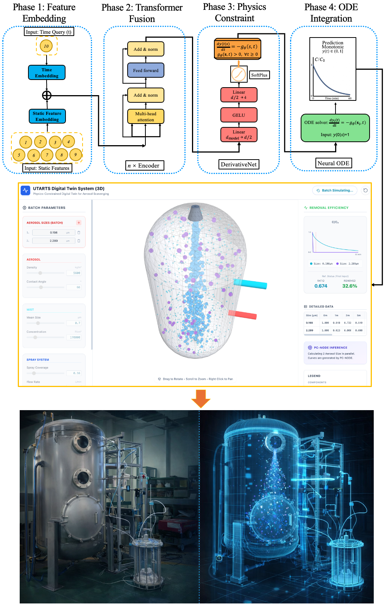
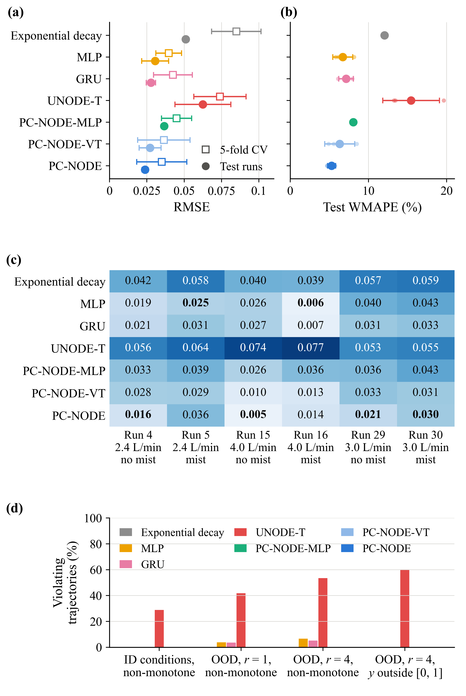
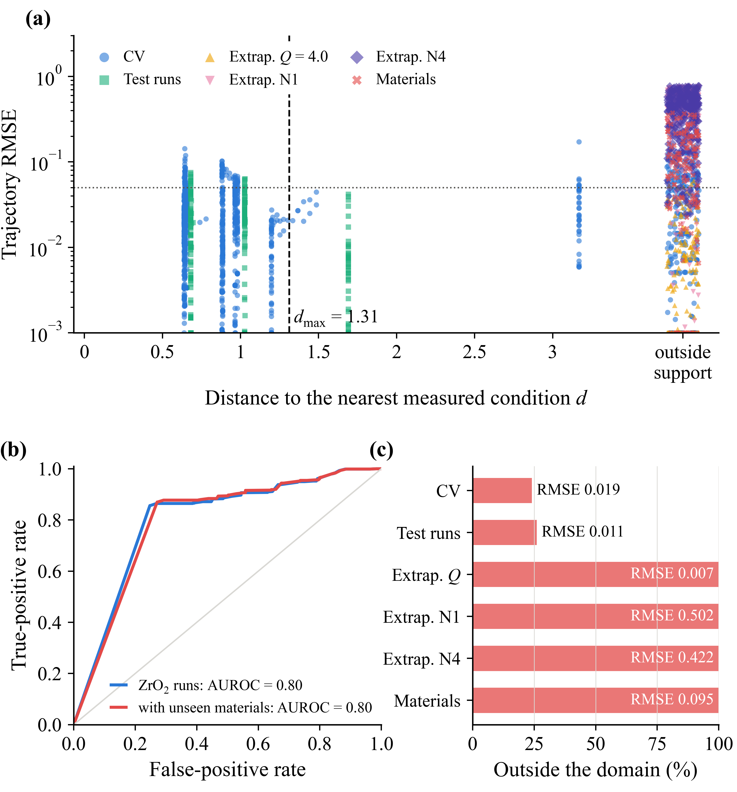
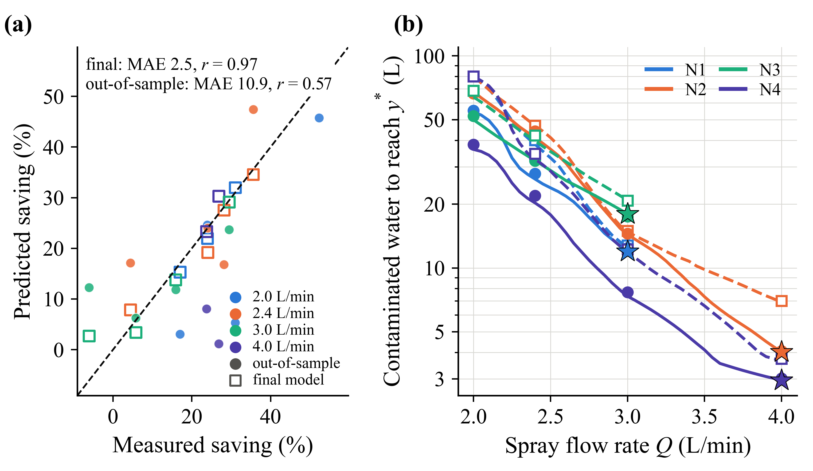

# PC-NODE Framework for Digital Twin

Code and trained model for the paper *A physics-constrained digital twin with applicability-domain safeguards for reliable aerosol control and contaminated water reduction in nuclear decommissioning*.

## Overview

Reliable control of radioactive aerosols is essential to the safe decommissioning of nuclear power plants. Insufficient spraying leaves airborne contamination, and excessive spraying generates contaminated water that has to be treated as radioactive waste. This repository provides the predictive core of a digital twin for aerosol scavenging, a Transformer-based physics-constrained neural ordinary differential equation (PC-NODE). The PC-NODE integrates $dy/dt = -g_\theta(s,t) y$ with $y(0) = 1$, where a Transformer computes a positive removal rate $g_\theta$ from the operating variables $s$ and the time $t$. Every predicted trajectory of the normalized aerosol concentration therefore starts at 1, stays within [0, 1] and decreases monotonically. By construction, the removal rate is non-decreasing in the spray flow rate, the mist mean concentration and the mist mean size. The released model was trained on 26 ZrO<sub>2</sub> runs of the University of Tokyo Aerosol Removal Test with Spray (UTARTS) facility and tested on six withheld runs.

## Framework and Digital Twin



*Fig. 4. PC-NODE workflow: feature embedding, Transformer fusion, physical constraints and neural ODE integration, together with the UTARTS digital-twin interface and experimental facility.*

## Highlights

- Hard constraints keep every predicted aerosol decay bounded and monotone
- Lowest test error of seven models, 14% below the best unconstrained one
- Median ZrO<sub>2</sub> error outside the applicability domain is 7.8 times that inside
- Attention and attribution trace decay stages to nozzle, spray flow rate and mist
- Screening within the domain finds settings with 72–96% less contaminated water

## Key Results



**Accuracy and physical consistency.** The PC-NODE gives the lowest test error of seven models and no physical violations.



**Applicability domain.** The applicability domain detects most unreliable predictions. Outside it, the median ZrO<sub>2</sub> error is 7.8 times that inside.



**Contaminated water reduction.** Within the applicability domain, the PC-NODE finds settings that need 72–96% less contaminated water than low-flow mist-free operation.

## Repository Structure

```
PC-NODE-Framework-for-Digital-Twin/
├── data/
│   ├── README.md            data availability and file format
│   └── example_input.csv    input format for inference
├── figures/                 figures of this README
├── models/
│   ├── pcnode.pt            trained PC-NODE weights (643,012 parameters)
│   ├── scaler.json          standardization of the operating variables
│   └── config.json          architecture and training settings
├── scripts/
│   ├── train.py             training on the 26 development runs
│   └── test.py              testing on the six test runs and inference
└── README.md
```

## Usage

```bash
pip install torch numpy pandas scikit-learn openpyxl
```

Training:

```bash
python scripts/train.py
```

Testing:

```bash
python scripts/test.py
```

Both scripts read the dataset from `data/aerosol_data.xlsx` (see `data/README.md`). `train.py` writes the weights, scaler and configuration of the retrained model to `outputs/`, and `python scripts/test.py --models outputs` evaluates it. `test.py` evaluates the released model in `models/` and prints R², RMSE, log-RMSE and WMAPE for each test run and for all six test runs.

The released model is the seed-0 model of Table 3 in the paper and gives R² = 0.9949, RMSE = 0.0236 and WMAPE = 5.43% on the six test runs. It was trained with Python 3.11, PyTorch 2.9.1 (CUDA 12.6), NumPy 2.4, pandas 2.3, scikit-learn 1.8 and openpyxl 3.1 on an NVIDIA RTX 6000 Ada GPU. In this environment, `train.py` reproduces the released weights exactly and `test.py` reproduces the metrics above. Other software versions and hardware give slightly different results.

Inference for new operating conditions:

```bash
python scripts/test.py --input data/example_input.csv --output predictions.csv
```

## Data Availability

The dataset is publicly at ./data.

## Citation

The citation will be added after publication.
