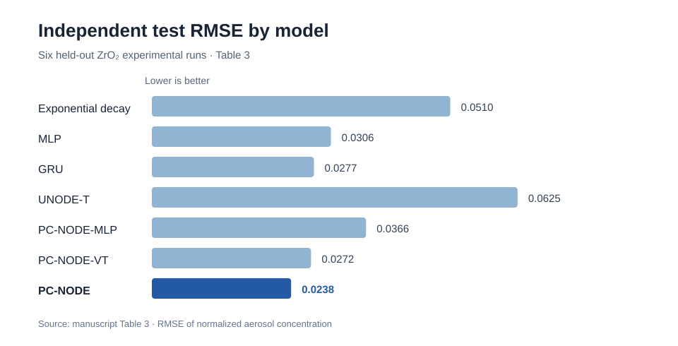
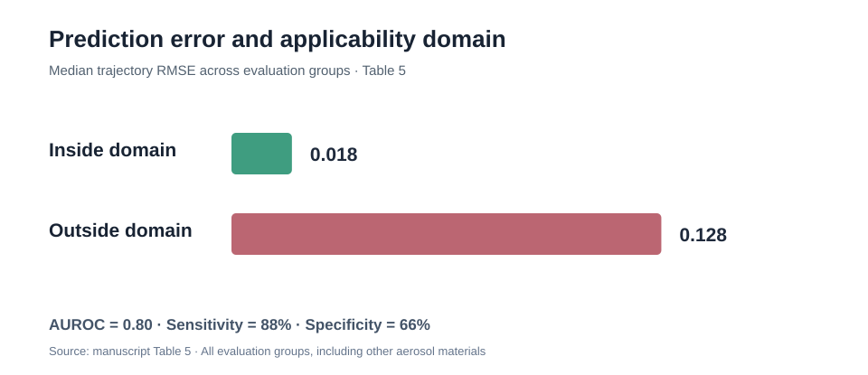
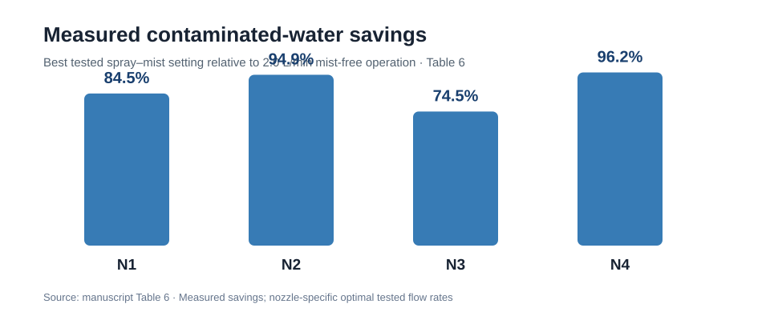

# Physics-Constrained Digital Twin for Aerosol Control in Nuclear Decommissioning

Research repository accompanying **“A physics-constrained digital twin with applicability-domain safeguards for reliable aerosol control and contaminated water reduction in nuclear decommissioning”** (manuscript prepared for *Reliability Engineering & System Safety*).

## Overview

Safe decommissioning of nuclear power plants requires reliable aerosol suppression without excessive generation of contaminated water. The study develops a Transformer-based, physics-constrained neural ordinary differential equation (PC-NODE) as the predictive core of a digital twin for spray–mist aerosol scavenging at the Fukushima Daiichi Nuclear Power Station. Positive removal-rate parameterization guarantees bounded, non-increasing normalized aerosol concentrations. An applicability domain identifies operating conditions for which predictive accuracy has experimental support, enabling applicability-aware assessment of aerosol removal and contaminated-water reduction.

## Highlights

- **Physical admissibility:** bounded concentration trajectories and monotonic decay by construction.
- **Predictive evaluation:** seven models compared under grouped cross-validation and a six-run hold-out protocol.
- **Reliability assessment:** applicability-domain screening complements physical constraints under distribution shift.
- **Engineering application:** spray–mist settings assessed against experimental contaminated-water requirements.
- **Material adaptation:** target-material measurements enable adaptation to SiC, CeO₂ and TiO₂ at a single tested operating condition.

## Key Results

**Independent predictive accuracy.** The PC-NODE achieved **R² = 0.9949**, **RMSE = 0.0238** and **WMAPE = 5.29%** on six held-out ZrO₂ runs (Table 3). The evaluated architecture contained **643,012 parameters**.



**Applicability domain.** All **23,802 stress-test trajectories** satisfied the physical admissibility checks. Across the groups reported in Table 5, median trajectory RMSE was **0.018** inside and **0.128** outside the applicability domain (AUROC **0.80**). Physical admissibility does not by itself guarantee predictive accuracy.



**Contaminated-water reduction.** For the tested nozzle configurations, the least-water spray–mist settings produced measured reductions of **72–96%** relative to the specified 2.0 L/min mist-free reference, depending on the nozzle and removal target (Table 6). These are retrospective comparisons of measured operating conditions, not independently validated full-scale plant operating limits.



## Repository Structure

```text
.
├── Aerosol data.xlsx
├── README.md
├── train_ode_Cm_Q.py
├── eval_ode_Cm_Q.py
├── paper_3.2_plot.py
├── paper_3.3_dm_Cm_for_saving water.py
├── transfer_compare.py
├── transfer_runs/
└── figures/
    ├── test-rmse.svg
    ├── applicability-domain.svg
    └── contaminated-water-savings.svg
```

The Python files are the **existing research scripts** for training, evaluation, visual analysis, water-use screening and transfer experiments. They currently preserve an earlier experimental configuration and **do not constitute a validated end-to-end implementation of the manuscript's grouped cross-validation and final training protocol**. The figures above are visual summaries of reported manuscript table values, not exports of the manuscript's original figures.

## Usage

Clone the repository and install the scientific Python dependencies:

```bash
git clone https://github.com/zhouzhouwen/PC-NODE-Framework-for-Digital-Twin.git
cd PC-NODE-Framework-for-Digital-Twin
python -m pip install torch numpy pandas scikit-learn joblib matplotlib openpyxl optuna
```

The existing scripts use local paths for input data and model checkpoints; configure these paths before execution.

### Training

```bash
python train_ode_Cm_Q.py
```

### Testing

```bash
python eval_ode_Cm_Q.py
```

Evaluation requires weights and scaling artifacts created by a compatible training run. The above commands execute the repository's existing script configurations; they are **not commands to reproduce Table 3 without the corresponding manuscript-specific scripts, data selection and saved model settings**.

## Data Availability

The repository contains `Aerosol data.xlsx` and research scripts. The manuscript reports **35 experimental runs and 14,595 measurement points** across materials, including **32 ZrO₂ runs and 13,650 ZrO₂ measurement points**. Data completeness and correspondence between the workbook and the final manuscript should be verified before claiming exact reproduction of published results.

## Citation

The manuscript is in preparation for journal submission. Bibliographic details and a DOI will be added after publication.

**Manuscript title:** *A physics-constrained digital twin with applicability-domain safeguards for reliable aerosol control and contaminated water reduction in nuclear decommissioning*.
