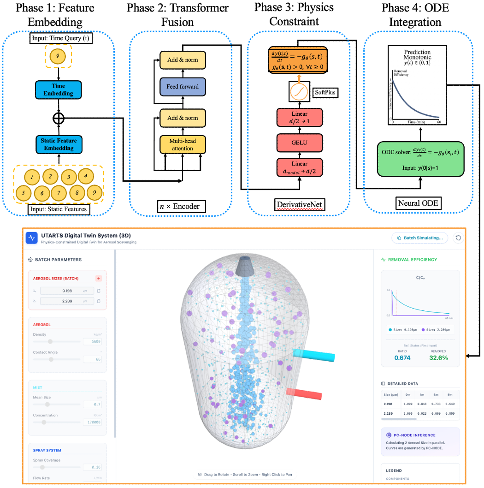

# PC-NODE Framework for Digital Twin

A research repository for a **physics-constrained AI digital twin** designed for **radioactive aerosol scavenging** in **nuclear decommissioning** scenarios.  
This project implements a **Transformer-based Physics-Constrained Neural Ordinary Differential Equation (PC-NODE)** to model aerosol removal dynamics under coupled spray–mist operating conditions, with a focus on **physical consistency**, **real-time inference**, **wastewater minimization**, and **transferability across materials**.

---

## Project Overview

Physically reliable and rapid prediction of hazardous aerosol removal is essential for environmental control and other safety-critical process systems, but existing methods still face a trade-off: empirical correlations generalize poorly, CFD is too expensive for real-time use, and unconstrained AI surrogates may violate basic physical laws. In this study, a transformer-based physics-constrained neural ordinary differential equation (PC-NODE) was developed as the predictive core of a digital twin for predicting the aerosol removal efficiency with pre-injection of water mist in the UTARTS (University of Tokyo Aerosol Removal Test with Spray) experimental facility. By combining hard physical constraints with a learned continuous-time dynamic kernel, the model enforces non-negative and monotonically decreasing aerosol concentration by construction while capturing the nonlinear effects of time and nine coupled operating variables. Using 32 experiments with 13,661 time points, the PC-NODE achieved high predictive accuracy on the ZrO2 aerosol material with R^2=0.998 and NRMSE =5.76%. For the fitted effective aerosol removal rate λ_s, the model achieved a MAPE of 4.98%, lower than the 6.17% of the CFD baseline. The digital twin was further applied to identify optimized mist settings that reduced contaminated water generation by up to 7.58%. Promising transferability was also observed: after pretraining on ZrO2, the model achieved R^2 > 0.95 on unseen SiC, CeO2, and TiO2 aerosol materials using only 10–30% of the target-domain data. The results provide an efficient and physically credible AI predictive core for digital twin–based aerosol removal in multiphase systems under nuclear decommissioning and environmental resource constraints.

All code for the training, testing, and deployment of the proposed PC-NODE is publicly available at https://github.com/zhouzhouwen/PC-NODE-Framework-for-Digital-Twin,
and the digital-twin demonstration is accessible at https://abroad-practitioner-promising-slight.trycloudflare.com


<p align="center">
  
</p>
<p align="center">
  Overview of the PC-NODE digital twin framework and UTARTS visualization interface.
</p>

---

## Tech Stack

This project is implemented in **Python** and currently relies on the scientific Python / deep learning ecosystem inferred from the source code.

Core libraries include:

- **PyTorch** — model definition and training
- **NumPy** — numerical operations
- **Pandas** — tabular data handling
- **scikit-learn** — preprocessing / scaling
- **joblib** — serialization of scalers
- **Optuna** — hyperparameter optimization
- **Matplotlib** — figure generation for paper results

---

## Installation

### 1. Clone the repository

```bash
git clone https://github.com/zhouzhouwen/PC-NODE-Framwork-for-Digital-Twin.git
cd PC-NODE-Framwork-for-Digital-Twin
```

### 2. Create a Python environment

Using `venv`:

```bash
python -m venv .venv
source .venv/bin/activate
```

On Windows:

```bash
.venv\Scripts\activate
```

Or using Conda:

```bash
conda create -n pc-node python=3.10 -y
conda activate pc-node
```

### 3. Install dependencies

Since a dependency file is not yet included, install the main packages manually:

```bash
pip install torch numpy pandas scikit-learn joblib matplotlib openpyxl optuna
```

> You may need to adjust the PyTorch installation command depending on your CUDA / CPU environment.

---

## Quick Start

### 1. Prepare the dataset

The current training script expects an **Excel dataset** with UTARTS experimental data and time-series concentration columns.

At present, the training code uses a hard-coded Excel path. Before running, update the dataset path in the script:

```python
EXCEL_FILE_PATH = "/path/to/your/data.xlsx"
```

### 2. Train the PC-NODE model

```bash
python train_ode_Cm_Q.py
```

This script trains the monotonic physics-constrained model and saves artifacts such as:

- trained model weights
- feature scaler
- prediction outputs
- evaluation metrics

### 3. Evaluate the trained model

```bash
python eval_ode_Cm_Q.py
```

### 4. Reproduce paper-related analysis

Plotting / analysis scripts currently included:

```bash
python paper_3.2_plot.py
python "paper_3.3_dm_Cm_for_saving water.py"
python transfer_compare.py
```

---

## Configuration

At the current stage, configuration is primarily script-based rather than centralized.

### Main configurable items

In the training / evaluation scripts, check and update:

- **dataset path**
  - `EXCEL_FILE_PATH`
- **sheet name**
  - `SHEET_NAME`
- **output file paths**
  - model checkpoints
  - scaler files
  - CSV metric outputs
- **training hyperparameters**
  - batch size
  - learning rate
  - number of epochs
  - model dimensions
- **feature / time column mappings**
  - static operating variables
  - time grid columns

### Dataset structure

The current code expects:

- **9 static operating variables**, including spray, mist, and aerosol properties
- concentration measurements at multiple time points such as:
  - `0min`, `1min`, `3min`, `5min`, `10min`, `15min`, `20min`, `30min`, `40min`, `50min`, `60min`

### Recommendation

For future improvement, it is recommended to move these settings into:

- a `config.yaml` or `config.json`
- CLI arguments
- an environment-based experiment configuration system

---

## Project Structure

```text
PC-NODE-Framwork-for-Digital-Twin/
├── README.md
├── train_ode_Cm_Q.py
├── eval_ode_Cm_Q.py
├── paper_3.2_plot.py
├── paper_3.3_dm_Cm_for_saving water.py
├── transfer_compare.py
└── transfer_runs/
```

### File descriptions

- **train_ode_Cm_Q.py**  
  Main training script for the physics-constrained monotonic PC-NODE model.

- **eval_ode_Cm_Q.py**  
  Evaluation / inference script for trained models.

- **paper_3.2_plot.py**  
  Plotting script associated with paper result visualization.

- **paper_3.3_dm_Cm_for_saving water.py**  
  Analysis script for mist operating conditions and water-saving optimization.

- **transfer_compare.py**  
  Transfer learning comparison workflow across particle/material datasets.

- **transfer_runs/**  
  Saved experiment outputs and transfer-learning run artifacts.

---

## Usage Example

A typical workflow is:

### Step 1 — Train on source-domain data

```bash
python train_ode_Cm_Q.py
```

### Step 2 — Evaluate model performance

```bash
python eval_ode_Cm_Q.py
```

### Step 3 — Generate figures / paper-style comparisons

```bash
python paper_3.2_plot.py
```

### Step 4 — Explore wastewater minimization settings

```bash
python "paper_3.3_dm_Cm_for_saving water.py"
```

### Step 5 — Run transfer-learning experiments

```bash
python transfer_compare.py
```

---

## Citation

If you use this repository in academic work, please cite the associated paper.

```bibtex
@article{zhou_pcnode_digital_twin,
  title   = {A Physics-Constrained AI Digital Twin for Radioactive Aerosol Scavenging and Wastewater Minimization in Nuclear Decommissioning},
  author  = {Zhou, Wen and Xu, Ruicong and Miwa, Shuichiro and Wang, Hanyu and Wang, Kai and Sharma, Avadhesh Kumar and Okamoto, Koji},
  journal = {To be updated},
  year    = {2026}
}
```

---

## Acknowledgment

This repository is developed for research on **physics-constrained AI surrogates**, **aerosol control**, and **digital twin modeling** for safety-critical multiphase engineering systems.
